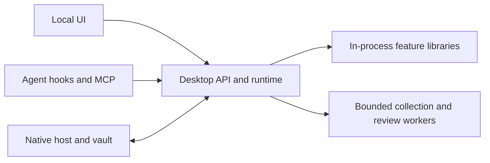

# Components, contracts, and the Desktop host

ADR Desktop is a local command center for people using agents. It should explain and configure features, not become the only place their algorithms can run. We are separating reusable libraries from the host incrementally, while retaining the same process, permission, and storage boundaries.

## Code modules are not services

The native menu-bar host starts one long-lived Python core. The local web UI calls that core over authenticated loopback HTTP. [Runtime](../adr_desktop/runtime.py) composes the features; [API routes](../adr_desktop/api.py) expose them to authorized callers. Feature libraries are imported into that process; they do not each start a server or collector.

Existing short-lived processes have specific purposes: a Sensor pass collects supported agents together, a Discovery scan is explicitly requested, hooks/MCP helpers serve harness invocations, and opted-in reviews supervise a local agent CLI. These isolation boundaries remain; this refactor does not add another daemon, database, port, or background scan.

## Packages and import rules

The product is two installable Python packages:

- **`adr-desktop`** ([Desktop/](../)): the app. Most of `adr_desktop` is still flat modules (runtime, API, CLI, hooks, store and the rest). Five subpackages have enforced import rules: [storage](../adr_desktop/storage/), [detection](../adr_desktop/detection/) with its inline part and its review part, [protection](../adr_desktop/protection/), [vault](../adr_desktop/vault/) and [integrations](../adr_desktop/integrations/).
- **`adr-sensor`** ([Sensor/](../../Sensor/)): two import packages, `adr_sensor` for activity capture and `adr_discovery` for AI inventory. It works without Desktop. Desktop pins one exact version.

The repository's top-level `Detection/` folder is the paper's benchmark and detector, a separate project; it is not Desktop's `detection` subpackage.

| Code | May import from Desktop |
| --- | --- |
| `storage` | nothing |
| `detection` | storage; its review part only storage's file helpers and IDs; its feed engine nothing |
| `protection` | detection |
| `vault` | detection and storage |
| `integrations` | the four subpackages above, no flat module |
| Desktop's flat modules | anything; Sensor and Discovery only through `adr_sensor.api` and `adr_discovery.api` |
| `adr_sensor`, `adr_discovery` | nothing; they do not import each other, and nothing inside them imports their `api` module |

The hook and prompt-guard entry points also import no FastAPI, uvicorn, Starlette, runtime, API, store, database layer, review code, Sensor or Discovery, which keeps the per-call process small. Detection, protection and vault keep the types that other code imports in `contracts.py`. Detection and vault declare what they need from Desktop in `ports.py`, and Desktop fills those ports.

`lint-imports` checks these rules in CI with the contracts in [`pyproject.toml`](../pyproject.toml), with no exceptions. A new top-level module in `adr_desktop`, `adr_sensor` or `adr_discovery` fails the check until it is added to a contract; a new module inside a subpackage follows its subpackage's rules.

## Ownership

| Area | Reusable component / contract | Desktop or native responsibility |
| --- | --- | --- |
| Activity capture | [Sensor](../../Sensor/): normalized agent events | The [collector](../adr_desktop/collector.py) schedules one Sensor pass; the host retains original snapshots and provides scoped search and presentation. |
| AI inventory | [Discovery](../../Sensor/DISCOVERY.md): snapshot and coverage records through `adr_discovery.api` | Request a bounded scan, persist results, paginate them, [explain access limits](../adr_desktop/access_status.py). Inventory is not prevention. |
| Artifact intelligence | Detection's [feed engine](../adr_desktop/detection/inline/feed/): offline artifact API v1 and the reviewed baseline feed. Detection's [artifact identity](../adr_desktop/detection/inline/artifacts.py) and [installed-item check](../adr_desktop/detection/inline/installed.py) find the files, skills, packages and MCP servers to match; they find agent config files through the `AgentConfig` [port](../adr_desktop/detection/ports.py), which [integrations.agents](../adr_desktop/integrations/agents.py) fills. | [Artifact coordination](../adr_desktop/threat_protection.py) supplies the reviewed baseline/custom feed, authorizes imports, publishes policy, runs the installed-item check, and stores findings and block records. [Operation evaluation](../adr_desktop/evaluate.py) enforces decisions. |
| File protection | [Protection](../adr_desktop/protection/): file rules and control paths, `Decision` and the closed reason codes, and the starter presets. It decides from the `Operation` that [operation parsing](../adr_desktop/detection/operation.py) reads, and imports nothing but Detection. | [Agent decode and encode](../adr_desktop/integrations/events.py) turn each agent's hook event into an `Operation` and a `Decision` back into its hook output. [Operation evaluation](../adr_desktop/evaluate.py) combines Protection's file rules with trust resolution and artifact matching. Approvals, guarded execution, and loading and publishing the policy file stay host responsibilities. |
| Security reviews | Detection's review part: the [review coordinator](../adr_desktop/detection/review/coordinator.py) (evidence, report validation, budgets, storage, scheduling) and the [CLI runners](../adr_desktop/detection/review/runners.py) with their isolation, watchdog, quota and usage. It reads captured sessions and device-idle time through the `SessionSource` and `DeviceIdle` [ports](../adr_desktop/detection/ports.py). | Desktop keeps [consent, settings](../adr_desktop/security_reviews.py) and the credential check. The [store](../adr_desktop/store.py) fills `SessionSource`, and the [security reviews module](../adr_desktop/security_reviews.py) fills `DeviceIdle` from the menu-bar app. These reviews are not the full `Detection/` benchmark pipeline. |
| Agent integration | [Integrations](../adr_desktop/integrations/): where each agent keeps its config files and ADR's plugin ([agents](../adr_desktop/integrations/agents.py), which fills Detection's `AgentConfig` port), and each agent's hook event decoded into an `Operation` and a `Decision` encoded back as its hook output ([events](../adr_desktop/integrations/events.py)). | [Hooks](../adr_desktop/hooks.py), [agent plugins](../adr_desktop/agent_plugins.py) and [MCP trust](../adr_desktop/mcp_trust.py) are still flat modules; they get agent facts from integrations, with no import cycle among them. The [MCP server](../adr_desktop/mcp_server.py) is also still a flat module. |
| Credentials | [Vault](../adr_desktop/vault/): saved-variable names and `vault-aliases.json`, credential-backed runs, the API broker and run audit, with no raw-value retrieval API. It reaches the native vault, protection decisions with approvals, and grants only through its `NativeVault`, `Guard` and `Grants` [ports](../adr_desktop/vault/ports.py), and imports nothing but Detection and Storage. | [Native vault code](../native/vault/) owns secret entry, encryption, operations, and output filtering. The [native bridge](../adr_desktop/native.py) fills `NativeVault`, [operation evaluation](../adr_desktop/evaluate.py) fills `Guard`, and the [runtime](../adr_desktop/runtime.py) fills `Grants` and tells the broker when it revokes a grant. [Credential activity](../adr_desktop/credential_activity.py) parses run receipts and joins runs with sessions. Detection's [credential and prompt patterns](../adr_desktop/detection/inline/credentials.py) reach saved values only through the `SavedValueCheck` [port](../adr_desktop/detection/ports.py), which the vault's environment coordinator fills through the native vault. |
| History and projections | Sensor/Discovery artifacts and future query-service interfaces | [Storage](../adr_desktop/storage/) holds the shared database connection, transactions, schema registration, stable IDs, and private profile files; it has no feature tables. The [store](../adr_desktop/store.py) owns immutable captures, derived indexes, and retention. The host authorizes access. |

Each component in the table is a subpackage of `adr-desktop`, not a separately installed library; only `adr-sensor` is released on its own. Module links identify where to work today, not stable library APIs. The one published library contract is the artifact feed engine's, below.

## Contributor-facing contract

The first stable library entry point is `adr_desktop.detection.inline.feed.api_v1`. It accepts supplied JSON-shaped data and returns validated data or matches. It does not accept Desktop's `Runtime`, open the profile, discover files, launch processes, call a model, or make network requests.

Its feed and generation schemas retain version 1. A compiled matcher can be reused for many lookups; import and construction do not create background work. See [`api_v1`](../adr_desktop/detection/inline/feed/api_v1.py) for supported functions and [`contracts.py`](../adr_desktop/detection/inline/feed/contracts.py) for the typed records. The golden fixture `tests/fixtures/artifact_v1.json` keeps the expected generation digest and match rows; do not regenerate it to make a changed engine pass.

New components should follow the same pattern:

- Make dependencies explicit through narrow inputs or host ports, not access to the entire Runtime or arbitrary SQL.
- Separate construction from lifecycle work. The host owns startup, recovery, cancellation, and shutdown order.
- Preserve useful uncertainty: configured is not observed enforcement; no match is not safe; a partial/error review is not clean.
- Publish typed inputs/outputs and fixed fixtures before callers depend on them.
- Keep source data and derived views separate. A presentation refactor must not rewrite captures, grants, or credential records.

## What is stable during extraction

The existing `adr-desktop`/`ADRCore` subcommands remain the compatibility façade. Generated plugin commands and the frozen executable identity are security-relevant: adding a wrapper or changing MCP argv can change the trust decision. Library extraction must not silently alter them.

Keep these boundaries unchanged unless a separate, reviewed migration explicitly changes them:

- Owner/browser, agent, and hook authorization; CSRF, Host/Origin checks, and scoped MCP tool sets.
- Native request/response messages and closed errors; secret values remain native.
- `policy.json` and `runtime.json` format 1, the guardian handoff, and existing profile paths.
- Database format 3, independently rebuildable history indexes, session/snapshot IDs, and existing narrow grants.
- The precedence of file denies, artifact matches, approvals, and post-approval rechecks.

There is no universal version number for every boundary. A package version, a feed schema version, a database version, and an application build number describe different things.

## Changing a published interface

The artifact v1 input schemas are intentionally closed. Changing accepted fields, interpretation, enum values, normalization, ordering, digest bytes, or failure behavior requires an explicit compatibility decision and, for incompatible changes, a new contract version. Adding an unrelated new API need not change existing v1 calls.

Every extraction keeps old-caller tests, fixed expected outputs, and frozen-build checks. `adr_desktop.threat_feed` only selects the bundled baseline feed; the engine is not duplicated. Moving code into the subpackages required no database or permission migration.

## Why the prototype was composed this way

Sharing one profile, lifecycle, and permission boundary made it possible to connect capture, hooks, vault use, and session-linked reviews without coordinating separate local services. The trade-off was too much feature logic and setup UI accumulating in Desktop.

We retain the useful runtime model and extract one independently testable responsibility at a time. Setup becomes one user-facing place, while individual feature pages remain focused on viewing activity, managing rules, using credentials, or reviewing findings.

The [development task list](DEVELOPMENT_TASKS.md) tracks what is implemented and what still needs extraction.
